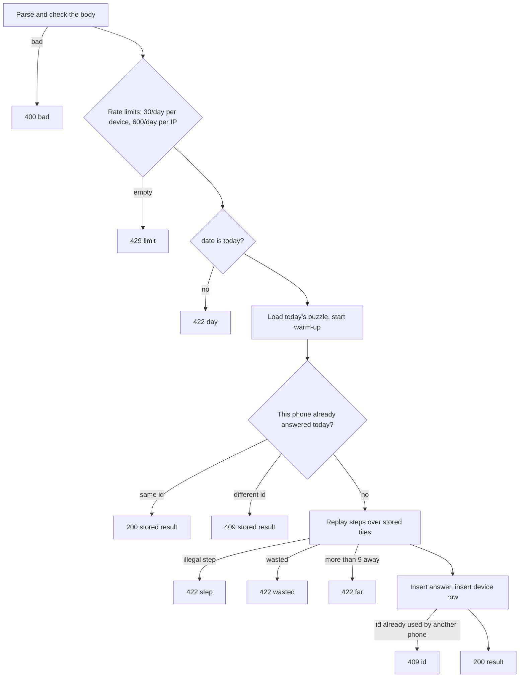

# API endpoints

Sixty4's server is TanStack Start alone: the same app that renders the page also serves a small JSON API, backed by SQLite (libSQL). This is the reference for every endpoint: what it accepts, what it checks and in what order, every response, and how the page uses it.

Every example below was run against the production build. The bodies are real responses.

## Contents

1. [Conventions](#conventions)
2. [`POST /api/answer`](#post-apianswer): send today's answer
3. [`DELETE /api/answer`](#delete-apianswer): forget today's answer, to replay it
4. [`GET /api/me`](#get-apime): this phone's recent results
5. [`POST /api/vitals`](#post-apivitals): one field Web Vitals measurement
6. [`GET /api/health`](#get-apihealth): is the server up
7. [The `getToday` server function](#the-gettoday-server-function): today's puzzle, for the page
8. [Error codes at a glance](#error-codes-at-a-glance)
9. [The tables behind the API](#the-tables-behind-the-api)

## Conventions

- **JSON in, JSON out.** Responses are built by `json()` in `src/server/http.ts` with `content-type: application/json` and **`cache-control: no-store`**, unless an endpoint says otherwise. Errors are `{ "error": "<code>" }` with a short, stable code.
- **No accounts.** A phone identifies itself with a **device ID**: a random UUID it makes the first time it needs one and keeps in `localStorage` (`mtn:device`). Device IDs and answer IDs are UUIDs, checked against a strict pattern and lowercased by the server.
- **India time.** A "day" runs from midnight to midnight India time (UTC+5:30), and only the server decides which day it is (`todayIST()` in `src/server/ist.ts`). Dates are `YYYY-MM-DD` strings.
- **Rate limits** are token buckets held in memory (`src/server/rateLimit.server.ts`). Each bucket starts full and refills evenly over 24 hours. They are per server process, so on several serverless instances the real limit is looser.
- **Compression.** On the Node server, `src/server.ts` compresses JSON and HTML with Brotli (quality 5) or gzip, based on `Accept-Encoding`. On Vercel the CDN does it.
- **Routes** are thin: each file in `src/routes/api/` just hands the request to a handler in `src/server/*.server.ts`, which the browser bundle can never import.

## `POST /api/answer`

Sends today's answer for scoring and saving. The server replays the steps over **its own stored tiles** and scores them with the shared rules (`src/game/rules.ts`). It never trusts points from the page. Each phone gets **one answer per day**, and sending is **idempotent** by answer ID. The only way to send a second answer the same day is to [reset](#delete-apianswer) first.

Handler: `handleAnswer` in `src/server/answers.server.ts`.

### Request

```http
POST /api/answer
Content-Type: application/json

{
  "id": "22222222-2222-4222-8222-222222222222",
  "deviceId": "11111111-1111-4111-8111-111111111111",
  "date": "2026-10-13",
  "steps": [
    { "a": 1, "op": "+", "b": 0 },
    { "a": 6, "op": "+", "b": 5 },
    { "a": 7, "op": "/", "b": 3 }
  ]
}
```

| Field | Rule (`parseAnswer`) |
| --- | --- |
| `id` | A UUID made on the phone when Send is tapped. It identifies this answer. |
| `deviceId` | A UUID: the phone's device ID |
| `date` | `YYYY-MM-DD`; must be **today** in India time (checked later) |
| `steps` | An array of **1 to 5** steps. Each step is `{ a, op, b }`: `a` and `b` are integers from 0 to 10 (slots 0 to 5 are the tiles, 6 to 10 the tiles made by earlier steps); `op` is one of `+ - * /`. |

Any extra fields are ignored. See [scoring.md](scoring.md#the-board-model) for how steps and slots work.

### What the server does, in order



1. **Parse.** A body that isn't JSON, or fails any rule above, gets **400 `bad`**. A malformed request uses no rate-limit tokens.
2. **Rate limits.** One token from the phone's bucket (**30 a day**), then one from the IP's bucket (**600 a day**, looser because many phones can share an IP). Every well-formed request uses tokens, including refused ones and retries. An empty bucket gets **429 `limit`**.
3. **Day.** If `date` isn't today in India time: **422 `day`**. This also catches an answer queued offline that only reconnects after midnight.
4. **Puzzle.** Load today's puzzle (memory, then the database, then make it). The first request of the day also starts the background warm-up: making tomorrow's puzzle and closing past days.
5. **Already answered?** Look up this phone's answer for today, using the unique `(device_id, date)` index:
   - The stored answer has **the same `id`**: it's a retry. **200** with the stored result.
   - It has **a different `id`**: the phone already answered today. **409** with the stored result. The first answer counts.

   This check comes **before** the steps are replayed, so once a phone has answered, any later request, even an invalid one, gets the stored result.
6. **Replay and judge** with `applySteps` and `score`:
   - illegal step (bad slot, reused slot, result not a positive whole number): **422 `step`**
   - the final tile is wasted (× 1, + 7 − 7 and the like): **422 `wasted`**
   - more than 9 from the target: **422 `far`**
7. **Save.** Insert the answer with its standard form, exactness and points. Then insert the device ID into `devices` if it's new. Both inserts ignore conflicts.
8. **Re-read.** Read this phone's answer back:
   - Found, and it's ours: **200** with the result.
   - Not found means the insert hit an existing `id` from **another phone**: **409 `id`**. With random UUIDs this practically never happens.

### Responses

| Status | Body | Meaning |
| --- | --- | --- |
| 200 | `{"points":60,"exact":true,"waysTotal":97}` | Saved, or a retry of the same answer |
| 409 | `{"points":60,"exact":true,"waysTotal":97}` | This phone already sent a different answer today. The body is the **stored** answer's result, which is the one that counts. |
| 409 | `{"error":"id"}` | The answer ID belongs to another phone's answer |
| 400 | `{"error":"bad"}` | Malformed body |
| 429 | `{"error":"limit"}` | Too many requests from this phone or IP today |
| 422 | `{"error":"day"}` | `date` isn't today in India time |
| 422 | `{"error":"step"}` | A step is illegal |
| 422 | `{"error":"wasted"}` | The answer has a wasted step |
| 422 | `{"error":"far"}` | The result is more than 9 from the target |

`points` excludes the rarity bonus, which is worked out after the day ends ([scoring.md](scoring.md#the-rarity-bonus)). `waysTotal` is how many different ways the puzzle has, for "You found 1 of N ways".

### Examples

Today's puzzle in these examples: tiles `4, 100, 2, 3, 4, 7`, target 37.

```bash
# (100 + 4 + 7) ÷ 3 = 37: exact, 4 tiles, 2 kinds
curl -X POST localhost:3000/api/answer -H 'content-type: application/json' -d '{
  "id": "22222222-2222-4222-8222-222222222222",
  "deviceId": "11111111-1111-4111-8111-111111111111",
  "date": "2026-10-13",
  "steps": [{"a":1,"op":"+","b":0},{"a":6,"op":"+","b":5},{"a":7,"op":"/","b":3}]
}'
# 200 {"points":60,"exact":true,"waysTotal":97}

# The same request again: a retry
# 200 {"points":60,"exact":true,"waysTotal":97}

# A new id from the same phone: the first answer stands
# 409 {"points":60,"exact":true,"waysTotal":97}

# From a phone with no answer yet:
#   steps [{"a":0,"op":"+","b":0}]                         → 422 {"error":"step"}    (same slot twice)
#   steps [{"a":1,"op":"+","b":0},{"a":6,"op":"-","b":4}]  → 422 {"error":"wasted"}  ((100 + 4) − 4)
#   steps [{"a":0,"op":"+","b":3}]                         → 422 {"error":"far"}     (4 + 3 = 7, 30 away)
#   "date": "2020-01-01"                                    → 422 {"error":"day"}
#   {"id":"x"}                                              → 400 {"error":"bad"}
```

### How the page uses it

`postAnswer()` in `src/client/send.ts` sends the body with `keepalive: true`, so the request survives the page closing, and maps the reply to one of three outcomes:

| Reply | Outcome | The page then |
| --- | --- | --- |
| 200 or any 409 | `saved` | Uses the server's points and marks the answer saved |
| 5xx, 429, or a network error | `offline` | Queues the answer in IndexedDB and retries later ([offline.md](offline.md#the-life-of-an-answer)) |
| Any other status | `refused` | Shows "This answer was not accepted" |

Treating 429 as "try later" rather than "refused" is deliberate: the limit refills over the day, so the answer can still go through.

**Known edge case.** The page treats *every* 409 as saved and reads `points` from the body. For the near-impossible `409 {"error":"id"}`, the body has no points. This isn't handled specially today.

## `DELETE /api/answer`

Forgets **this phone's answer for today**, so it can be played and sent again for real. The hidden debug menu's "Reset today's puzzle" uses it, so someone who has played for many days can replay the day's puzzle through the whole real flow.

Handler: `handleReset` in `src/server/answers.server.ts`.

### Request

```http
DELETE /api/answer?deviceId=11111111-1111-4111-8111-111111111111
```

A missing or malformed `deviceId` gets **400 `bad`**. There's no body.

### What the server does

1. **Rate limits.** One token from the phone's **reset** bucket (30 a day, separate from the answer bucket, so testing doesn't use up answers), then one from the shared IP bucket (600 a day). An empty bucket gets **429 `limit`**.
2. **Delete** this device's row in `answers` for **today** (India time). Past days are never touched, closed or not. The `devices` row stays.
3. Reply with how many answers were deleted.

### Responses

| Status | Body | Meaning |
| --- | --- | --- |
| 200 | `{"deleted":1}` | Today's answer is gone. The next `POST` is saved as a new answer (200, not 409). |
| 200 | `{"deleted":0}` | There was no answer for today. Nothing changed. |
| 400 | `{"error":"bad"}` | Malformed `deviceId` |
| 429 | `{"error":"limit"}` | Too many resets from this phone, or requests from this IP, today |

```bash
curl -X POST localhost:3000/api/answer ...                      # 200 {"points":60,...}
curl -X POST localhost:3000/api/answer ... (a new id)           # 409 (the first answer stands)
curl -X DELETE 'localhost:3000/api/answer?deviceId=1111...1111'  # 200 {"deleted":1}
curl -X DELETE 'localhost:3000/api/answer?deviceId=1111...1111'  # 200 {"deleted":0}
curl -X POST localhost:3000/api/answer ... (the new id)         # 200 {"points":60,...}
```

### Fairness

There's no secret or sign-in: any phone can reset its **own** answer for today, as often as the rate limit allows. This was a deliberate choice, to keep the debug menu usable on the live site. The trade-offs:

- A player who finds the hidden menu can retry today's puzzle, for example to raise their points or aim for a rarer way.
- Until the day closes, deleting and resending changes the counts that rarity shares come from ([scoring.md](scoring.md#the-rarity-bonus)). Once the day has closed, bonuses are fixed, and past answers can't be deleted.
- A phone can only ever delete its own answer: the delete is keyed by device ID, and device IDs are random UUIDs.

### How the page uses it

`resetToday()` in `src/client/Debug.tsx`:

1. Sends the `DELETE`. If it fails (offline, or not 200), the menu says "Couldn't reach the server. Try again when online." and **nothing changes**, on the phone or the server.
2. On success, it drops the old answer from the offline queue if it is still waiting there, so a late Background Sync can't resend it.
3. It removes today's steps, today's answer and today's history entry from `localStorage`.
4. It remounts the game as the real puzzle, with an empty board.

## `GET /api/me`

Returns this phone's recent results: points for the last 35 days, and yesterday's result in detail with its rarity bonus. The page uses it to rebuild history (the streak, the grid, "Days this week") and to show "Yesterday: 2 of 3 players found your way, +4".

Handler: `handleMe` in `src/server/me.server.ts`.

### Request

```http
GET /api/me?deviceId=11111111-1111-4111-8111-111111111111
If-None-Match: "blaxVqGcrJWAldKG"     (optional)
```

A missing or malformed `deviceId` gets **400 `bad`**.

### What the server does

1. **Close past days first.** It awaits `closePastDays(today)`, so every finished day has its rarity bonuses written before anything is read. Normally this is a fast no-op. On the first call of a day it may do the day close itself ([scoring.md](scoring.md#the-day-close)).
2. **Read the last 35 days, today included:** `date`, `points` and `rarity_bonus` for every answer from this device since today minus 34 days.
3. **Read yesterday in detail**, with two counts over all of yesterday's answers:
   - `same`: answers with the same standard form as this phone's, this phone included
   - `players`: all answers that day
4. **Make an ETag** from the response body (the first 16 characters of a base64url SHA-1). If the request's `If-None-Match` matches, reply **304** with no body.

### Response

```http
200 OK
content-type: application/json
cache-control: private, no-cache
etag: "blaxVqGcrJWAldKG"

{"yesterday":null,"days":[["2026-10-13",60,0]]}
```

```ts
// src/game/puzzle.ts
interface MeBody {
  yesterday: {
    points: number   // yesterday's points, without the bonus
    bonus: number    // the rarity bonus (0 if not exact)
    exact: boolean
    same: number     // answers that day with the same standard form, yours included
    players: number  // all answers that day
  } | null           // null if this phone didn't answer yesterday
  days: Array<[date: string, points: number, bonus: number]> // oldest first
}
```

- `bonus` in `days` is 0 for today, because a day's bonus is only known once it has closed. The page ignores it for today (see below).
- `same` and `players` count **all** answers, while the bonus counts only **exact** answers. See [scoring.md](scoring.md#what-the-player-sees-the-next-day).
- `private, no-cache` keeps shared caches from storing one phone's data, and makes the browser revalidate each time. With the ETag, a repeat check is a cheap 304.

| Status | Body |
| --- | --- |
| 200 | `MeBody` |
| 304 | none (`If-None-Match` matched) |
| 400 | `{"error":"bad"}` |

### How the page uses it

`syncHistory()` in `src/client/me.ts` calls it at idle time, at most once a day (it stores the date in `mtn:me`), and only when local history is empty or yesterday's bonus is unknown. It merges `days` and `yesterday` into local history, keeping only the points for today, so tomorrow's page still knows yesterday's bonus needs fetching. A failed call is ignored.

## `POST /api/vitals`

Records one real-user Web Vitals measurement. The page sends these from 25% of visits using `navigator.sendBeacon`, which survives the page closing.

Handler: `handleVitals` in `src/server/vitals.server.ts`.

### Request

The body is read as **text** and parsed as JSON, so it works with `sendBeacon`'s `text/plain` content type.

```http
POST /api/vitals

{"name":"LCP","value":1234.5,"rating":"good","target":"main>section>strong"}
```

| Field | Rule |
| --- | --- |
| `name` | `LCP`, `INP` or `CLS` |
| `value` | A finite number, 0 or more (milliseconds for LCP and INP; a unitless score for CLS) |
| `rating` | `good`, `needs-improvement` or `poor` |
| `target` | Optional. The CSS selector of the element behind the value, from web-vitals' attribution build, at most 100 characters |

The body must be a JSON object (`null`, a number or a string gets 400 too) and pass these rules. It is checked first, then a rate limit of **200 a day per IP**. The measurement is stored in the `vitals` table with today's India date.

### Responses

| Status | Body | Meaning |
| --- | --- | --- |
| 204 | none | Stored |
| 400 | `{"error":"bad"}` | Malformed body |
| 429 | none | Too many from this IP today |

```bash
curl -X POST localhost:3000/api/vitals -d '{"name":"LCP","value":1234.5,"rating":"good"}'   # 204
curl -X POST localhost:3000/api/vitals -d '{"name":"FID","value":1,"rating":"good"}'      # 400 {"error":"bad"}
```

The page never reads the reply: `sendBeacon` doesn't expose it.

## `GET /api/health`

Reports whether the server can reach its database, by running `SELECT 1`.

Handler: `healthCheck` in `src/server/health.server.ts`.

| Status | Body |
| --- | --- |
| 200 | `{"ok":true}` |
| 503 | `{"ok":false}` (the database didn't answer) |

Playwright's `webServer` waits on it before running the e2e tests (`playwright.config.ts`). It also suits a hosting platform's health check. The first call opens the database and runs any pending migrations, so it doubles as a warm-up.

## The `getToday` server function

The page doesn't fetch the puzzle from a REST endpoint. The `/` route's loader calls a **server function**:

```ts
// src/functions/getToday.ts
export const getToday = createServerFn({ method: 'GET' }).handler(() => loadToday())
```

- During server rendering, the loader runs on the server and the puzzle goes straight into the HTML. If the router ever navigates on the client, Start turns the same call into a `GET` to an internal URL it generates. That URL is an implementation detail, not a public API.
- It returns `TodayPuzzle` (`src/game/puzzle.ts`):

  ```ts
  { date: '2026-10-13', number: 2, tiles: [4, 100, 2, 3, 4, 7], target: 37, waysTotal: 97 }
  ```

  It **never** includes the solutions: those are the answer key and stay on the server.
- `loadToday()` (`src/server/today.server.ts`) also sets the response's cache header to `public, max-age=0, s-maxage=<seconds until India midnight>, stale-while-revalidate=60`, so a CDN can share one copy of the page with everyone until the day changes, and starts the day's warm-up.

## Error codes at a glance

| Code | Status | Endpoint | Meaning | Page treats it as |
| --- | --- | --- | --- | --- |
| `bad` | 400 | all | Malformed request | refused |
| `limit` | 429 | answer | Rate limit hit | offline, retried later |
| `limit` | 429 | reset (`DELETE /api/answer`) | Reset limit hit | "Couldn't reach the server" in the debug menu |
| `day` | 422 | answer | Not today's date (India time) | refused |
| `step` | 422 | answer | An illegal step | refused |
| `wasted` | 422 | answer | A wasted step | refused |
| `far` | 422 | answer | More than 9 from the target | refused |
| `id` | 409 | answer | Answer ID belongs to another phone | saved (see the edge case above) |
| (none) | 429 | vitals | Rate limit hit | ignored |
| (none) | 503 | health | Database down | |

## The tables behind the API

Defined in `src/server/db/schema.ts` with Drizzle. Migrations live in `drizzle/` and are bundled into the server build, so they run automatically wherever the server starts.

| Table | Columns | Notes |
| --- | --- | --- |
| `puzzles` | `date` (key), `number` (unique), `tiles` (JSON), `target`, `solutions` (JSON), `ways_total`, `closed_at` | One row per India date. Made once, never regenerated. `closed_at` is set by the day close. |
| `answers` | `id` (key, the phone's UUID), `device_id`, `date`, `steps` (JSON), `canonical`, `exact`, `points`, `rarity_bonus`, `created_at` | **Unique `(device_id, date)`**: one answer per phone per day (a reset deletes it). Index on `(date, canonical)` for rarity counts. `rarity_bonus` stays empty until the day closes. |
| `devices` | `device_id` (key), `reminder_slot`, `push_subscription`, `created_at` | A row per phone that has answered. The reminder and push columns are reserved for a future feature. |
| `vitals` | `id`, `name`, `value`, `rating`, `target`, `date` | Field measurements from `/api/vitals`. Index on `date`. |

The database is a local SQLite file by default (`DATABASE_URL=file:data/sixty4.db`, in WAL mode), or a Turso database in production (`DATABASE_URL` and `DATABASE_AUTH_TOKEN`).
