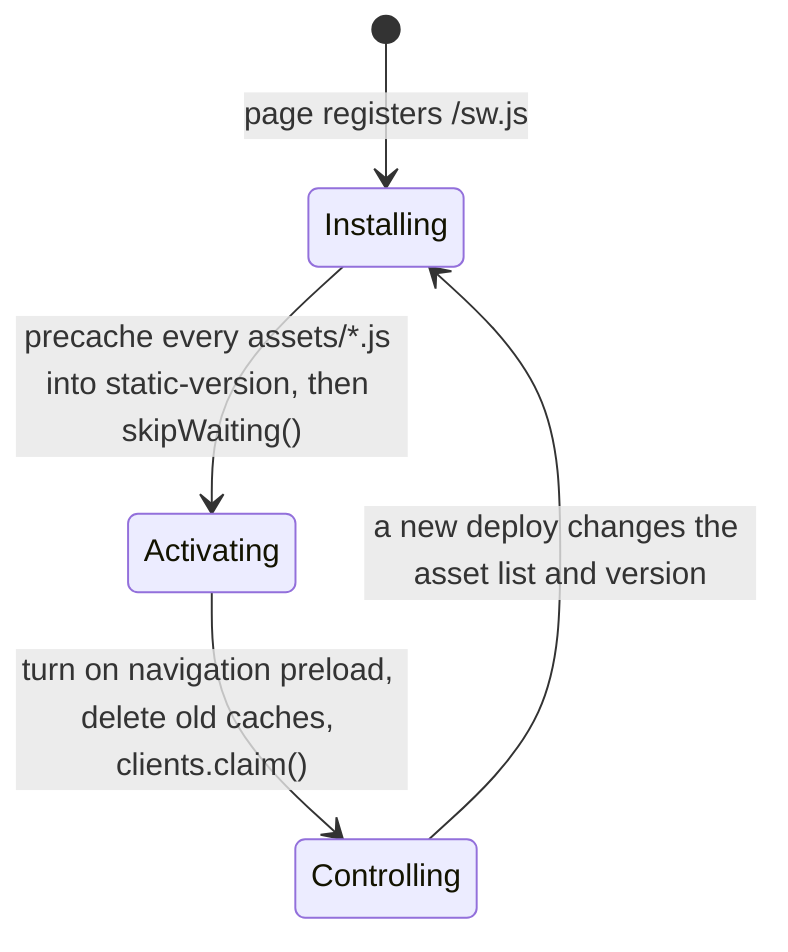
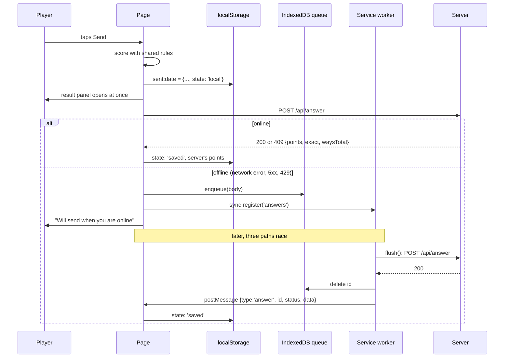

# Offline-first architecture

Sixty4 is built to be played on a phone with a weak or missing connection. Once the page has loaded once, it opens offline, keeps every step, and an answer sent offline reaches the server later on its own. This explains how, including the service worker, `localStorage` and the IndexedDB queue.

The short version:

- **The phone is the source of truth for personal data.** The server only stores answers. Everything else (device ID, steps, today's answer, history) lives in `localStorage`.
- **Work is saved after every step**, so a reload, a crash or a lost connection never loses progress.
- **A hand-written service worker** (`src/sw/sw.js`) serves the page and its scripts from cache when the network is slow or gone.
- **Answers sent offline wait in IndexedDB.** They are sent by Background Sync where the browser has it, and otherwise by the page when it comes back online or opens again.
- **Sending is idempotent.** Each answer has a UUID made on the phone, so sending it twice, or by two paths at once, is harmless.

## Contents

1. [Principles](#principles)
2. [What lives where](#what-lives-where)
3. [The service worker](#the-service-worker)
4. [IndexedDB: the answer queue](#indexeddb-the-answer-queue)
5. [The life of an answer](#the-life-of-an-answer)
6. [Restoring history from the server](#restoring-history-from-the-server)
7. [Limits and edge cases](#limits-and-edge-cases)
8. [How it is tested](#how-it-is-tested)

## Principles

**1. The HTML is the same for everyone.** The server renders only the day's puzzle: number, tiles, target. Nothing personal is in the HTML. Personal data is read from `localStorage` in an effect **after hydration** (`Game.tsx`, the first `useEffect`), into space the layout already reserves, so nothing shifts when it appears. Because the page is identical for everyone, it is sent with:

```
cache-control: public, max-age=0, s-maxage=<seconds until India midnight>, stale-while-revalidate=60
```

A CDN can serve one copy to every player until the day changes, and the service worker can keep a copy for offline use without it ever going stale for a player.

**2. Save after every step.** The in-progress step list is written to `localStorage` on every change. Reopening the page replays the saved steps with `applySteps`, so the board looks exactly as it was left.

**3. Answers are idempotent.** When the player taps Send, the page makes a UUID for the answer (`uuid()` in `src/client/storage.ts`). The server keys answers by that ID:

- the same ID again gets the same reply (200)
- a different answer from the same phone on the same day gets 409 with the stored result

So any number of retries, from any number of paths, end in one stored answer. See [api.md](api.md#post-apianswer).

**4. Show the result at once.** The page scores the answer with the same rules as the server (`src/game/rules.ts`) and opens the result panel immediately, online or not. The server's reply replaces the page's result when it arrives.

## What lives where

| Where | What | Who reads it |
| --- | --- | --- |
| HTML (cached by CDN and service worker) | Today's puzzle: date, number, tiles, target, ways count | Everyone |
| `localStorage` (`mtn:` prefix) | Personal state, see the table below | The page only |
| IndexedDB `mtn` / `queue` | Answers waiting to reach the server | The page **and** the service worker |
| Cache Storage `static-<version>` | The hashed JS files of the current build | The service worker |
| Cache Storage `pages` | The last good copy of each page, by path | The service worker |
| Server database | Answers, puzzles, device IDs, field vitals | The server |

### `localStorage` keys

All keys are prefixed `mtn:`. Every read and write goes through `read`, `write` and `remove` in `src/client/storage.ts`, which catch errors, so private mode, full storage or blocked storage never breaks the game. The game still plays; it just can't remember anything.

| Key | Holds | Written | Cleared |
| --- | --- | --- | --- |
| `device` | A random UUID that identifies this phone. There is no sign-up. | The first time it is needed | Never |
| `steps:<date>` | The in-progress step list for that India date | After every step, until the answer is sent | `tidy()` on a later day |
| `sent:<date>` | Today's answer: steps, points, breakdown, and `state`: `local`, `saved` or `refused` | On Send, and again when the server answers | `tidy()` on a later day |
| `steps:<date>~p`, `sent:<date>~p` | The same two, for a debug-menu practice puzzle | During practice | When a practice starts or ends, and by `tidy()` |
| `practice` | The current practice puzzle (tiles, target) | From the debug menu | "Back to the real puzzle"; ignored on other days |
| `history` | Points per date, plus yesterday's bonus details | On Send, when the server confirms, and after `/api/me` | Entries older than 40 days are dropped |
| `me` | The date `/api/me` was last fetched, so it is fetched at most once a day | After a successful fetch | "Clear history" in the debug menu |
| `vitals` | `"all"` forces field vitals on for this phone (used by the e2e test) | By hand or by tests | Never |

`tidy(today)` runs when the game opens. It removes every `steps:` and `sent:` key, practice ones included, for dates before today.

## The service worker

The service worker is 80 lines of plain JavaScript (`src/sw/sw.js`). It is hand-written rather than generated by a library so it stays under its 2 KB budget. At build time `sw-plugin.ts`:

- takes the list of hashed `assets/*.js` files from the client build
- makes a version string from a hash of that list
- puts both into the template in place of `__VERSION__` and `__ASSETS__`
- minifies the result with `rolldown/utils`
- writes it to `/sw.js`

CSS doesn't need caching: it is inlined into the HTML.

**Registration.** The page registers `/sw.js` from `src/client/idle.ts`. That runs only after first paint, when the browser is idle, and only in production builds, so the worker never competes with the first load. `/sw.js` is served with `cache-control: no-cache`, so a new deploy is noticed on the next visit.

### Lifecycle



- **Install** opens `static-<version>`, downloads every script of the build (`cache.addAll`), then calls `skipWaiting()`, so a new version takes over straight away instead of waiting for every tab to close.
- **Activate** turns on **navigation preload**, deletes every cache except the current `static-<version>` and `pages`, and calls `clients.claim()` to control open pages at once.

### Request routing

The worker only looks at same-origin `GET` requests:

| Request | Strategy |
| --- | --- |
| Page navigations (`/`, `/how-it-works`) | **Network first, 2-second limit, then cache** (below) |
| `/assets/*.js` | **Cache first.** Hashed file names never change content, so the cached copy is always right. On a miss it falls back to the network. |
| Everything else, including all `/api/*` calls | Not handled: goes straight to the network |

The API is deliberately not cached by the worker. Answers have their own queue (below), and `/api/me` has its own ETag handling.

**How a page navigation is served** (`page()` in `sw.js`):

1. Start the network request. With navigation preload, the browser has already started fetching the page while the worker was starting, so this costs no extra time.
2. If the response is good, save a copy in the `pages` cache under its path. The save runs alongside (`waitUntil`), so it never holds the page back.
3. Race the network against a **2-second timer**:
   - The network wins: serve it. This is the normal case, and the player always gets today's page.
   - The timer wins or the network fails: look in the `pages` cache.
     - **A copy from today** (India time, judged by the copy's `Date` header): serve it at once, and let the network request finish in the background (`waitUntil`) to refresh the cache for next time.
     - **A copy from an earlier day:** it has yesterday's puzzle, so keep waiting for the network. The old copy is used only if the network fails outright. That's better than nothing offline, and the page then says the day is over (below).
     - **No copy:** wait for the network after all.

**A page from an earlier day says so.** The game compares its puzzle's date with today's India date by the phone's clock, after hydration and again whenever the tab becomes visible. If the puzzle is older, the line under the title becomes a link: "This day is over. A new number is ready." That catches a page served offline from the cache, and a tab left open overnight. The server's date still decides what counts: a wrong phone clock can only show this link, never block play.

On a repeat visit this means only the HTML crosses the network (about 3.5 KB compressed). Every script comes from the worker's cache. The e2e test checks that a repeat visit stays at 5 KB or less.

## IndexedDB: the answer queue

### Why IndexedDB

A service worker **cannot read `localStorage`**: it is synchronous and only exists in pages. IndexedDB is available to both pages and workers, and it outlives the page. That makes it the one place where the page can leave an answer and the service worker can find it later, even after the tab is closed.

The queue is the only thing in IndexedDB. Everything else stays in `localStorage`, which is simpler and synchronous.

### Schema

| | |
| --- | --- |
| Database | `mtn`, version 1 |
| Object store | `queue` |
| Key | `id` (the answer's UUID, as `keyPath`) |
| Value | The exact request body: `{ id, deviceId, date, steps }` |

The schema is opened in **two places**: `src/client/queue.ts` for the page and `store()` in `src/sw/sw.js` for the worker. Both create the store in `onupgradeneeded`. **They must change together.** A new version number or store in one but not the other would break the handover.

Because the key is the answer ID, `put` is an upsert: queueing the same answer again just replaces it.

### The page side (`src/client/queue.ts`)

```ts
enqueue(body) // put the body in the queue, then ask for a Background Sync
dequeue(id)   // remove an answer once the server has answered it
```

`enqueue` also calls `registration.sync.register('answers')` when the browser supports Background Sync. That asks the browser to wake the service worker with a `sync` event once it is online, **even if the page has been closed**. Both functions swallow errors: a failure only means a later retry path is needed.

The queue module is loaded only when it is needed (`import('./queue')`), so it costs nothing on a normal online day.

The debug menu's "Reset today's puzzle" also calls `dequeue`, after the server has confirmed the reset. Otherwise an old answer still waiting in the queue could be resent by a late Background Sync and become today's answer again.

### The worker side (`flush()` in `sw.js`)

On a `sync` event tagged `answers`, the worker runs `flush()`:

1. Read every queued answer (`getAll`).
2. `POST` each one to `/api/answer`.
3. If the server answers 5xx or 429, **throw**. The browser treats the sync as failed and retries it later, with its own backoff. The answer stays in the queue. A network failure throws too, with the same effect.
4. Otherwise, the server has decided (saved, already saved, or refused for good): delete the answer from the queue, and `postMessage` the outcome to every open page:

```js
{ type: 'answer', id, status, data } // data is the JSON body
```

The page listens for these messages (`src/client/idle.ts`) and passes them to `settle()` in `Game.tsx`, the same function every other path uses.

## The life of an answer



Step by step:

1. **Send.** `onSend()` scores the answer, makes its UUID, writes it to `sent:<date>` with `state: 'local'`, records the points in history, and opens the result panel. All of this happens before any network call.
2. **First try.** An effect in `Game.tsx` runs whenever there is an answer in state `local`. It calls `postAnswer()` (`src/client/send.ts`, with `keepalive: true` so the request survives the page closing). That has three outcomes:

   | Outcome | When | What the page does |
   | --- | --- | --- |
   | `saved` | 200, or 409 (this phone already has an answer today; the stored one counts) | Takes the server's points, `state: 'saved'` |
   | `refused` | Any other 4xx (`day`, `step`, `wasted`, `far`, `bad`) | `state: 'refused'`: "This answer was not accepted" |
   | `offline` | Network error, any 5xx, or 429 | Queues the answer in IndexedDB and shows "Will send when you are online" |

3. **Retries.** While the answer is still `local`, three paths try again, and whichever finishes first wins:
   - **Background Sync** (Chromium browsers): the service worker's `flush()`, even with the page closed.
   - **The `online` event**: the same effect listens for it and calls `postAnswer()` again.
   - **The next open**: `sent:<date>` still says `local`, so the effect runs again on load.
4. **Settle once.** Every path ends in `settle(id, outcome)`. It reads the **current** `sent:<date>` and does nothing unless that answer has the same ID and is still `local`. So a late or duplicate reply can never overwrite a settled answer. Once settled, it removes the answer from the IndexedDB queue (`dequeue`).

Duplicates are expected and harmless: Background Sync and the `online` event can both post the same answer. The server sees the same ID, finds the stored row and returns the same reply.

## Restoring history from the server

The phone's history drives the streak, the 6-week grid and "Days this week". If the history is lost but the device ID survives (for example after "Clear history" in the debug menu, or when only some keys are cleared), it is rebuilt from the server:

- At idle time, if local history is **empty**, or yesterday's entry has **no bonus yet**, the page loads `src/client/me.ts` and calls `syncHistory`.
- `syncHistory` does nothing if it already ran today (`mtn:me`). Otherwise it calls `GET /api/me?deviceId=…` and merges the reply into local history: the last 35 days as `[date, points, bonus]`, plus yesterday's details (`same`, `players`, `bonus`) for the "Yesterday: …" line. Today's row keeps only its points: the server reports today's bonus as 0 because it isn't known yet, and saving that 0 would make tomorrow's page think yesterday's bonus was already fetched.
- `/api/me` replies with an `ETag` and `cache-control: private, no-cache`, so a repeat check costs a 304 with no body.

The device ID itself lives only in `localStorage`. If it is lost, the server has no way to link the phone to its old answers. That is the cost of having no sign-up.

## Limits and edge cases

- **Background Sync is Chromium-only.** On Safari and Firefox, an offline answer is sent when the page sees the `online` event or the next time the game is opened. It is never lost, just sent later.
- **Crossing midnight.** If an answer is sent offline and the phone only reconnects after midnight India time, the server refuses it with 422 `day`. The panel then says the answer was not accepted. The points recorded in history at send time stay. (Opening the app just after midnight on a slow network doesn't hit this: the service worker won't serve yesterday's page while the network is still answering.)
- **No storage.** With `localStorage` blocked, the game plays normally but forgets steps on reload, and every visit looks like a new phone.
- **First visit offline.** The service worker only exists after one online visit, so the very first visit needs a connection.
- **The page cache is per path and not versioned.** Each page keeps its last good copy, refreshed on every successful navigation. After a deploy, the next online visit replaces it.
- **The worker is production-only.** `pnpm dev` doesn't register it. Test offline behaviour with `pnpm build && pnpm start`.

## How it is tested

| Test | What it checks |
| --- | --- |
| `e2e/offline.spec.ts`: "opens offline from the service worker, with work kept" | Makes a step, goes offline, reloads. The page comes from the worker's cache and the step is still there. |
| `e2e/offline.spec.ts`: "a repeat visit transfers 5 KB or less" | On reload, no script touches the network (all come from the worker), and page plus HTML bytes stay at 5 KB or less (about 3.5 KB now). |
| `e2e/day.spec.ts`: "sends while offline, then saves when back online" | Sends offline, sees "Will send when you are online", goes online, sees "Saved". |
| `e2e/yesterday.spec.ts` | Clears storage, keeps only the device ID, and checks that the history and yesterday's line come back from `/api/me`. |
| `e2e/day.spec.ts`: "plays a full day" | Reloads part-way: the steps come back from `localStorage`. |
| `e2e/day.spec.ts`: "a page from an earlier day says so" | With the phone clock set to tomorrow, the line under the title becomes the "This day is over" link. |
| `e2e/yesterday.spec.ts`: "a sync after today's answer leaves today's bonus unknown" | After answering, clearing history and syncing, today's entry has points but no bonus, so tomorrow fetches the real one. |
