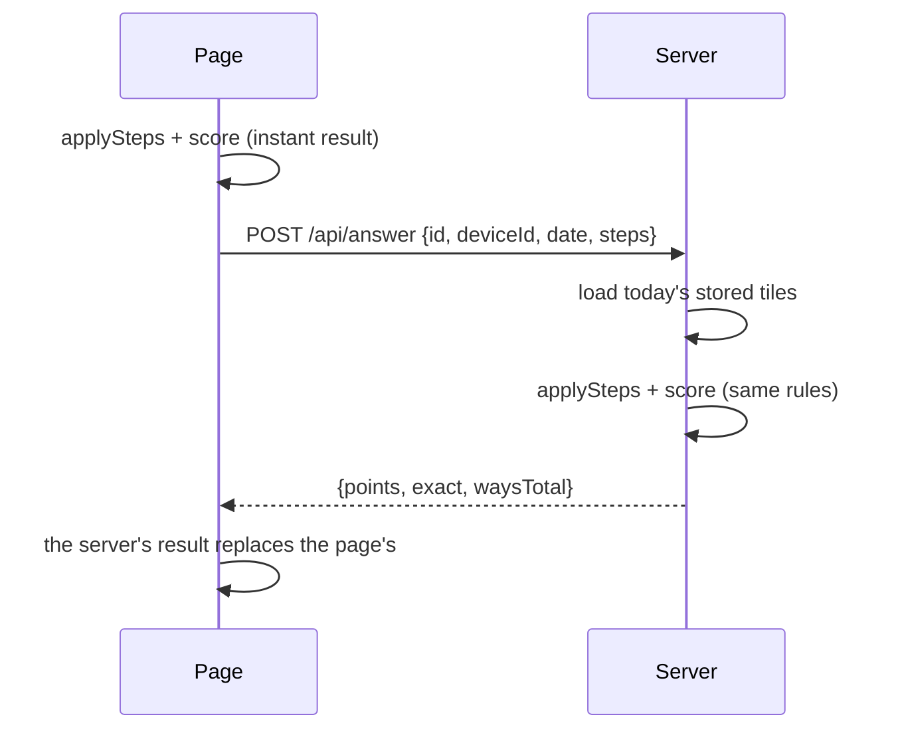

# Scoring, and how players compare

This explains how an answer is checked and scored, how it is compared with everyone else's answers for the day, and where each piece lives in the code.

The short version:

- The page and the server run **the same rules** (`src/game/rules.ts`). The page scores instantly; the server replays the steps and its result is the one that counts.
- An exact answer scores **10 per tile used + 10 per kind of operation used** (at most 100). A near answer scores **3 × (10 − distance)** when it is 1 to 9 away.
- **Wasted** steps (× 1, + 7 − 7 and the like) make an answer worth 0, and the server refuses it.
- The next day, each exact answer gets a **rarity bonus** of up to +50, based on how few of the day's exact solvers found the same way.
- There is **no leaderboard**. Rarity is the only way one player's answer is measured against others.

## Contents

1. [The board model](#the-board-model)
2. [Legal steps](#legal-steps)
3. [Wasted steps](#wasted-steps)
4. [The standard form: what counts as "the same way"](#the-standard-form-what-counts-as-the-same-way)
5. [Points](#points)
6. [A worked example](#a-worked-example)
7. [Who decides the score](#who-decides-the-score)
8. [The rarity bonus](#the-rarity-bonus)
9. [The day close](#the-day-close)
10. [What the player sees the next day](#what-the-player-sees-the-next-day)
11. ["You found 1 of N ways"](#you-found-1-of-n-ways)
12. [How puzzles are made](#how-puzzles-are-made)
13. [Streaks and history](#streaks-and-history)

## The board model

A puzzle is 6 tiles and a target. The player merges two tiles at a time with + − × ÷. Each merge removes both tiles and adds one new tile.

The board is a list of **slots**. Slots 0 to 5 are the original tiles. Each step adds one new slot at the end, so 5 steps (the most possible with 6 tiles) fill slots 6 to 10. A step is three values:

```ts
interface Step {
  a: number // slot on the left
  op: '+' | '-' | '*' | '/'
  b: number // slot on the right
}
```

`applySteps(tiles, steps)` replays a step list from scratch and returns the board: every slot, which slots are used up, the newest tile (`last`), and the first error, if any. Both the page and the server call it. Nothing about the board is stored except the step list.

Every tile is an `Expr`, a small tree that carries everything scoring needs, worked out one step at a time:

| Field | Meaning |
| --- | --- |
| `v` | The tile's value |
| `k` | Group kind: `'a'` for + and −, `'m'` for × and ÷, `''` for an original tile |
| `p`, `n` | Plus terms and minus terms (for `'a'`), or top and bottom factors (for `'m'`) |
| `c` | The standard form, a string used to tell answers apart |
| `t` | How many original tiles the expression uses |
| `o` | Kinds of operation used, as bits: + 1, − 2, × 4, ÷ 8 |
| `w` | Why the expression is wasted (`'one'`, `'add'`, `'mul'`), or `''` |

`combine(x, op, y)` builds the new tile. Its key move is **flattening**: when a step continues the same group, the terms are pulled into one list rather than nested. `(100 + 4) + 2` becomes one `+` group with terms `100, 4, 2`, not a `+` inside a `+`. Subtraction and division put the right-hand side into the minus or bottom list, and they flip that side's own lists when it is a group of the same kind. So `a − (b − c)` becomes plus terms `a, c` and minus term `b`. Flattening is what makes the waste check, the standard form and the operation count cheap and order-independent.

## Legal steps

`calc(x, op, y)` only allows results that are **positive whole numbers**:

| Step | Allowed when | Otherwise |
| --- | --- | --- |
| `x + y` | always | |
| `x − y` | `x > y` | error `zero` (0 or below) |
| `x × y` | always | |
| `x ÷ y` | `y` divides `x` exactly | error `fraction` |

A step is also rejected (error `slot`) if it uses the same slot twice, a slot that does not exist yet, or a slot already merged. The page never lets a player make an illegal step. It disables those buttons. The server replays every step anyway and answers 422 `step` for any of these errors.

## Wasted steps

A step that does nothing useful is **wasted**. `groupWaste` checks the flattened group each time a tile is made:

| Code | Rule | Examples |
| --- | --- | --- |
| `one` | In a × ÷ group, any factor worth exactly 1 | `7 × 1`, `9 ÷ 1`, `6 × (3 − 2)` |
| `add` | In a + − group, some set of plus terms adds up to the same value as some set of minus terms | `(10 + 7) − 7`, and also `(10 + 3 + 4) − 7`, because 3 + 4 = 7 |
| `mul` | In a × ÷ group, some set of top factors multiplies to the same value as some set of bottom factors | `(10 × 3) ÷ 3` |

The `add` and `mul` checks try every non-empty subset of each side (`subsetValues`). Groups have at most 6 terms, so that is at most 63 subsets per side.

Waste **spreads upward**: a tile made from a wasted tile is wasted too (`w ||= e.w`). If any part of the final answer is wasted, the whole answer is.

What happens to a wasted answer:

- The page shows why, for example "Adding and taking away the same amount does nothing", and Send stays disabled.
- `score()` gives it 0 points.
- The server refuses it with 422 `wasted`.

Only the final tile is judged. A wasted tile that the player made but did not use in the final answer does not matter.

## The standard form: what counts as "the same way"

Each expression has a standard form `c`, built in `combine`: the group sign, then the plus terms' forms sorted, then the minus sign and the minus terms' forms sorted:

```
4 + 3              →  (+ 3 4)
3 + 4              →  (+ 3 4)
(4 + 2) + 1        →  (+ 1 2 4)
4 + (2 + 1)        →  (+ 1 2 4)
(1 + 4) + 2        →  (+ 1 2 4)
(9 − 4) − 2        →  (+ 9 - 2 4)
9 − (4 + 2)        →  (+ 9 - 2 4)
```

Because groups are flattened and sorted, **reordering and regrouping the same tiles with the same operations give the same form**. Using different tiles always gives a different form, even when the value is the same.

The standard form is what the server stores as `answers.canonical`. It is how the rarity bonus counts "players who found your way", and there is an index on `(date, canonical)` for that count.

## Points

`score(expr, target)` in `src/game/rules.ts`:

```ts
if (e.w) points = 0                                   // wasted
else if (distance === 0) points = 10 * tiles + 10 * kinds  // exact
else if (distance <= 9) points = 3 * (10 - distance)       // near
else points = 0
```

**Exact answers.** `tiles` is how many original tiles the answer uses (`t`). `kinds` is how many of + − × ÷ appear in it (the bits in `o`, counted by `kindsCount`):

| Tiles \ Kinds | 1 | 2 | 3 | 4 |
| --- | --- | --- | --- | --- |
| 3 tiles | 40 | 50 | 60 | 70 |
| 4 tiles | 50 | 60 | 70 | 80 |
| 5 tiles | 60 | 70 | 80 | 90 |
| 6 tiles | 70 | 80 | 90 | 100 |

Daily puzzles never have a 2-tile solution (see [How puzzles are made](#how-puzzles-are-made)), so in practice an exact answer uses at least 3 tiles and scores 40 to 100. The design rewards **longer, more varied answers**, not just reaching the target.

How kinds are counted: a group of kind `'a'` adds + when it has more than one plus term, and − when it has any minus term. A group of kind `'m'` does the same for × and ÷. Because the count comes from the flattened groups, it matches the operations the player actually used.

**Near answers** score 27 for 1 away, down to 3 for 9 away:

| Distance | 1 | 2 | 3 | 4 | 5 | 6 | 7 | 8 | 9 | 10+ |
| --- | --- | --- | --- | --- | --- | --- | --- | --- | --- | --- |
| Points | 27 | 24 | 21 | 18 | 15 | 12 | 9 | 6 | 3 | 0 |

Exact answers score 40 or more and near answers 27 or less, so the bands never overlap.

**What can be sent.** `canSend(expr, target)` needs:

- at least one step (`e.k !== ''`)
- no waste
- a result within 9 of the target

After 5 steps with a result more than 9 away, the page says "Get within 9 of the target to send". The server applies the same limit and answers 422 `far`.

## A worked example

Tiles `4, 100, 2, 3, 4, 7`, target 293. These values come from running the real functions:

| Step | Merge | Value | Standard form | Tiles | Kinds so far |
| --- | --- | --- | --- | --- | --- |
| 1 | 4 + 100 | 104 | `(+ 100 4)` | 2 | + |
| 2 | 2 + 104 | 106 | `(+ 100 2 4)` | 3 | + |
| 3 | 106 − 7 | 99 | `(+ 100 2 4 - 7)` | 4 | + − |
| 4 | 3 × 99 | 297 | `(* (+ 100 2 4 - 7) 3)` | 5 | + − × |
| 5 | 297 − 4 | 293 | `(+ (* (+ 100 2 4 - 7) 3) - 4)` | 6 | + − × |

- Sent after step 5: exact, 6 tiles and 3 kinds, so **60 + 30 = 90 points**. The result panel shows "6 tiles: 60, 3 kinds: 30".
- Sent after step 4 (297, 4 away): **3 × (10 − 4) = 18 points**.

## Who decides the score



- The page computes the score at once, so the result panel opens with no waiting, even offline.
- The server never trusts the page's points. It gets only the **step list**, replays it over **its own stored tiles** for today, and scores it again.
- The server's reply replaces the page's result (`settle()` in `src/client/Game.tsx`). The two only differ if the page was tampered with.
- Practice puzzles from the debug menu ("Play this target", "New tiles") are scored on the page only and never sent. "Reset today's puzzle" is different: it deletes this phone's answer on the server, so the replayed answer is sent and scored for real.

See [api.md](api.md#post-apianswer) for every check the server makes, and in what order.

## The rarity bonus

This is the only way a player is measured against other players. The question it answers is: **how unusual was your way of reaching the target?**

For one day, look only at the **exact** answers. Group them by standard form. If your form was sent by a share `p` of the day's exact solvers, your bonus is:

```ts
// src/server/rarity.ts
rarityBonus(p) = Math.min(50, Math.round(25 * Math.log10(1 / p)))
```

| Share who found your way (`p`) | Bonus |
| --- | --- |
| everyone (100%) | 0 |
| 2 in 3 | +4 |
| half | +8 |
| 1 in 4 | +15 |
| 1 in 10 | +25 |
| 1 in 20 | +33 |
| 1 in 100 | +50 |
| rarer than 1 in 100 | +50 (the cap) |

Things to know:

- **Near and wasted answers get 0.** Only exact answers take part, as numerator and denominator.
- **You need other solvers to earn a bonus.** If you are the only exact solver, `p = 1` and the bonus is 0. If two players each find a different way, each has `p = 1/2` and gets +8.
- The scale is logarithmic: every tenfold rarer way earns 25 more, up to 50. The How it works page shows the same rule as "+25 if 1 in 10 did, +50 if 1 in 100 did".
- **A reset can shift the shares until the day closes.** The debug menu's "Reset today's puzzle" deletes a phone's answer for today ([api.md](api.md#delete-apianswer)), and the phone can then send a different one. The counts used for `p` are only taken at the day close, so they reflect whatever answers are stored then.
- The bonus is stored apart from the points (`answers.rarity_bonus` and `answers.points`) and shown apart. Points are known at once; the bonus only once the day is over.

## The day close

Bonuses can only be worked out when the day is over and every answer is in. There is **no cron job**. The day close runs lazily (`src/server/dayClose.server.ts`):

- **What starts it:**
  - `warmUp(today)` in `src/server/puzzles.server.ts` runs on the **first request of each India day** in each server process, from both the page loader and `POST /api/answer`. It starts `closePastDays(today)` in the background and also makes tomorrow's puzzle.
  - `GET /api/me` **awaits** `closePastDays(today)` before it reads anything, so it always sees closed days.
- **What it does,** for each past day whose puzzle row still has `closed_at IS NULL`:
  1. Open one write transaction.
  2. Check again that the day is still open. This check inside the transaction is what makes the close happen exactly once, even if two requests start it together.
  3. Count the exact answers per standard form: `SELECT canonical, COUNT(*) … WHERE date = ? AND exact = 1 GROUP BY canonical`.
  4. Write every exact answer's bonus in **one** statement: `UPDATE answers SET rarity_bonus = CASE canonical WHEN ? THEN ? … ELSE 0 END`.
  5. Set `rarity_bonus = 0` on the day's non-exact answers.
  6. Set `puzzles.closed_at`, commit, and drop the day from the in-memory puzzle cache.

Days are in **India time** (UTC+5:30). Only the server decides what day it is (`src/server/ist.ts`).

## What the player sees the next day

When the page opens and doesn't yet know yesterday's bonus, it calls `GET /api/me` at idle time (`src/client/me.ts`). The reply's `yesterday` object holds:

| Field | Meaning |
| --- | --- |
| `points` | Yesterday's points, without the bonus |
| `bonus` | The rarity bonus |
| `exact` | Whether the answer was exact |
| `same` | How many answers that day had the same standard form, yours included |
| `players` | How many answers there were that day in total |

The game shows it under the title:

- if yesterday scored 40 or more (an exact answer): "Yesterday: 2 of 3 players found your way, +4"
- otherwise: "Yesterday: 18 points"

**A subtlety:** `same` and `players` count **all** of the day's answers, while the bonus's `p` counts only **exact** answers. They agree when everyone who answered was exact, as in the e2e test where 2 of 3 exact solvers share a way, `p = 2/3` and the bonus is +4. On a day with near answers, `same / players` can differ from the `p` used for the bonus.

## "You found 1 of N ways"

When the answer is exact, the result panel says "You found 1 of N ways". `N` is `waysTotal`, worked out when the puzzle is made:

- `solve(tiles, target)` in `src/server/solve.server.ts` lists **every different non-wasted way** to reach the target.
- It uses dynamic programming over the 63 non-empty subsets of tiles, smallest first. For each subset it keeps one expression per standard form, built by combining every split into two smaller subsets with every legal operation.
- Values above **20,000** are dropped along the way to keep the search bounded.
- The result is stored in `puzzles.solutions` with `waysTotal = solutions.length`.

Two consequences:

- The solution list is the **answer key**. It lives only on the server. The budget check fails the build if the strings `__SOLVER__` or `solutions` appear in any browser chunk.
- A player can, rarely, find a valid way that passes through a value above 20,000. The server still accepts and scores it, since it replays steps rather than looking them up, but that way is not counted in `N`.

## How puzzles are made

`makePuzzle(date)` in `src/server/makePuzzle.server.ts`:

1. Seed a random generator from the date (`cyrb53` hash into `mulberry32`). **The same date always gives the same puzzle.**
2. Draw tiles: 1 or 2 big tiles from 25, 50, 75 and 100, the rest from 1 to 10, shuffled.
3. Draw a target from the day's range (below).
4. Solve. Keep the draw only if it has **enough ways** for its place in the ramp, **at most 300 ways**, and **no way that uses only 2 tiles**. Otherwise draw again from the same seed, up to 50 times.

Puzzles get harder over the first 30 days, counted from `LAUNCH_DATE` (`rampFor(n)`):

| Puzzle | Target range | Fewest ways |
| --- | --- | --- |
| #1 | 20–99 | 40 |
| #10 | 28–186 | 31 |
| #20 | 55–485 | 20 |
| #30 and later | 101–999 | 10 |

The target range widens with the square of progress, so the first week stays mostly two-digit. More ways means an easier puzzle, which is why the minimum starts high. From #30 on, the generator produces exactly the puzzles it made before the ramp existed.

Puzzles are made once and stored in the `puzzles` table. A stored puzzle always wins over making it again, so changing the generator never changes a day that already exists. Tomorrow's puzzle is made in the background ahead of time, on a worker thread (`src/server/solverWorker.server.ts`), so solving never blocks a request.

## Streaks and history

Personal history lives on the phone, in `localStorage` under `mtn:history`:

```ts
// India date → that day's result
{ "2026-10-12": { points: 90, bonus: 25, same: 3, players: 140 } }
```

- `record(points)` in `src/client/Game.tsx` writes today's points **as soon as the answer is sent**, using the page's score, so the streak updates even offline. When the server confirms, `settle()` records the server's points over them. Entries older than 40 days are dropped. A refused answer's entry stays.
- `syncHistory` merges in the server's last 35 days and yesterday's details from `/api/me`.
- `points` never includes the bonus. They are separate fields because they arrive on different days.

From this history, `src/client/history.ts` and `src/client/StreakGrid.tsx` work out:

- **The streak**, shown as "12-day streak" from 2 days up: the number of days played in a row, counting back from today, or from yesterday while today is still open, so an unplayed today never breaks it.
- **The 6-week grid** in the result panel: one cell per day, a row per India week (Monday to Sunday). Played days are marigold at opacity `0.3 + 0.7 × min(points, 100) / 100`, so better days are brighter.
- **"Days this week"** in the header: days played since Monday.
